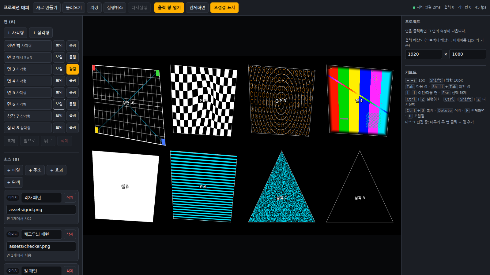
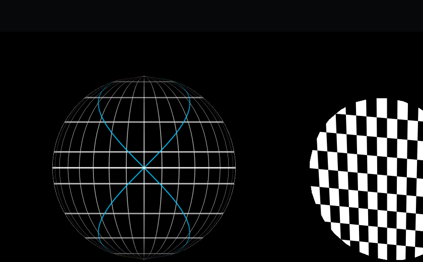
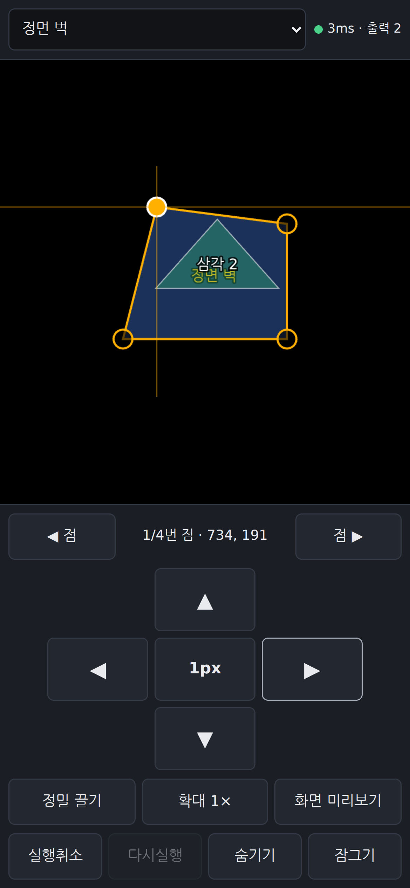

# 프로젝션 매퍼 (Projection Mapper)

브라우저만으로 쓰는 프로젝션 매핑 도구입니다. 프로젝터에 연결한 PC 에 **출력 화면**을 띄우고, PC·태블릿의 **편집기**나 폰의 **리모컨**으로 면의 모서리를 끌어 레고 모형, 상자, 캔버스, 공 같은 입체물에 영상을 맞춰 비춥니다. 사용하는 쪽은 설치가 필요 없고, 서버를 켜는 PC 에만 Node.js 가 필요합니다.

*A browser-based projection mapping tool: warp videos and effects onto physical objects (boxes, LEGO models, canvases, spheres) by dragging corners from a PC, tablet or phone. UI is in Korean.*



## 할 수 있는 것

- **사각형 면**: 네 모서리를 끌면 원근이 정확히 맞습니다(호모그래피, GPU 원근 보정 — 대각선 꺾임 없음).
- **삼각형 면**(지붕 박공 등), **메시 면**(2~12 × 2~12 격자점, 휜 면).
- **둥근 것**: 원형 마스크, 공(구) 모양 메시(경선·위선 격자). 크기 조절 상자와 "원으로 맞추기"로 한 번에 맞춥니다.
- **여러 점 한꺼번에**: 크기 조절 상자(변·모서리·이동), 여러 점 선택(Shift+클릭/끌기, 줄·열), 1px·10px 미세 조정.
- **마스크**: 다각형으로 면 바깥을 잘라내고 가장자리를 부드럽게(페더).
- **소스**: 영상(mp4·webm·mov), 이미지, 효과 4종(스캔라인·노이즈·단색 깜빡임·격자), 단색. 격자는 선·테두리 두께(출력 픽셀)와 가로·세로 칸 수를 조절합니다. 매핑용 8초 반복 영상 3종(빛 훑기·테두리 네온·벽돌 쌓기)이 기본으로 들어 있습니다. 테스트 패턴(기본 격자·대각선 격자·체크무늬·원) 포함.
- **세팅용 격자 화면**: 프로젝터가 비추는 범위를 블랙·블루·그린 바탕의 격자로 채워 보여 줍니다.
- **화면 3개 실시간 연결**: 출력(프로젝터), 편집기(PC·태블릿), 리모컨(폰). 같은 PC 창끼리는 서버 없이도, 다른 기기는 WebSocket 으로 연결됩니다.
- **저장/불러오기**: 매핑 전체를 JSON 파일 하나로 저장. 브라우저와 서버에도 자동 저장되어 새로고침해도 그대로입니다.

| 공 모양 메시 + 원형 마스크 | 폰 리모컨 |
|---|---|
|  |  |

## 켜기

필요한 것: **Node.js 22.18 이상**, 최신 Chrome·Edge·Safari(WebGL2).

```bash
git clone https://github.com/SJC-PBK/3d_projecter_mapping.git
cd 3d_projecter_mapping
npm install
npm run dev                  # 개발용. 주소와 폰용 QR 코드가 화면에 나옵니다
# 또는 배포용 (인터넷 없이 동작)
npm run build && npm start
```

- 이 PC: `http://localhost:5200/` · 같은 와이파이의 폰·태블릿: 화면에 나온 주소나 QR.
- 화면: 출력 `/output/` · 편집기 `/editor/` · 리모컨 `/remote/`
- 환경변수: `PORT`(기본 5200), `HOST`(기본 0.0.0.0, `127.0.0.1` 이면 이 PC 에서만), `MEDIA_DIR`(편집기에서 올린 파일을 둘 폴더, 기본 `./media`), `STATE_FILE`(지금 매핑을 저장할 파일, 기본 `./data/project.json` — 서버를 다시 켜도 매핑이 남습니다)
- 폰·태블릿이 붙지 않으면 서버 PC 의 방화벽에서 그 포트를 **같은 망(개인 네트워크)에만** 열어 주세요.

## 쓰는 순서

1. 프로젝터를 PC 에 연결하고 **프로젝터 자체의 키스톤(사다리꼴) 보정은 끕니다.** 보정은 이 앱에서만 합니다.
2. 편집기에서 **출력 창 열기** → 그 창을 프로젝터 화면으로 옮기고 두 번 클릭(전체화면). 다른 PC 에서 출력한다면 그 PC 브라우저로 `/output/` 을 엽니다.
3. 편집기 위쪽 **격자 화면** 선택상자(G 키)로 프로젝터가 어디까지 비추는지 보고 위치·초점을 맞춥니다.
4. **+ 사각형 / + 삼각형**으로 면을 만들고(처음엔 검은 바탕에 흰 선의 기본 격자), 점을 끌어 모형의 모서리에 맞춥니다. 정밀 조정은 방향키(1px, Shift 10px)나 폰 리모컨으로.
5. 휜 면은 **메시로 바꾸기**, 둥근 면은 **원형 마스크 / 공(구) 모양으로**, 튀어나온 부분은 **마스크**.
6. 면마다 소스를 고르고(**+ 파일**로 영상 올리기), **저장**으로 JSON 을 받아 둡니다.

출력 화면: 두 번 클릭 = 전체화면, `I` = 성능 정보(fps). 편집기 키보드: 방향키 이동, Tab 다음 점, Ctrl+Z 실행취소, Ctrl+D 복제, B 크기 조절 상자, G 격자 화면, F 전체화면, H 조절점 숨김.

## ⚠ 보안 주의

이 앱은 **혼자 쓰는 PC 나 믿을 수 있는 사내망·개인 와이파이**에서 쓰도록 만들었습니다. **로그인이 없습니다.** 같은 망에 있는 누구나 편집기를 열어 매핑을 바꾸고, 파일(한 개 300MB 까지)을 서버에 올릴 수 있습니다.

- 인터넷에 그대로 열거나 공용 와이파이에서 켜 두지 마세요.
- 외부에 공개해야 한다면 앞에 인증이 있는 리버스 프록시를 두세요.
- 올린 파일은 `MEDIA_DIR` 에 쌓이므로 행사가 끝나면 정리하세요.

## 구조

```
server/index.ts      정적 파일 + WebSocket 중계(/ws) + 파일 올리기 + LAN 주소·QR 출력 (Node, 빌드 없이 실행)
src/core/            순수 함수: 호모그래피, 메시 보간(Catmull-Rom), 프로젝트 파일 검증·마이그레이션, 변경분, 여러 점 계산
src/render/          WebGL2 렌더러, 워프·마스크·효과 셰이더, 이미지·영상 텍스처
src/sync/            BroadcastChannel + WebSocket 동기화
src/ui/, src/pages/  편집기·출력·리모컨 화면
tests/               Vitest 단위 테스트
```

- `npm test` 단위 테스트 · `npm run typecheck` 타입 검사 · `npm run assets` 테스트 패턴 다시 만들기
- 기술: TypeScript(strict), Vite, WebGL2 직접 사용, 서버 의존성은 `ws`·`qrcode-terminal` 두 개.
- 프로젝트 파일(JSON)에는 `version` 이 있고, 모든 좌표는 출력 해상도와 무관한 0~1 값입니다.

## 참고한 것

[MapMap](https://github.com/mapmapteam/mapmap), [Splash](https://github.com/paperManu/splash), [ofxPiMapper](https://github.com/kr15h/ofxPiMapper) 의 **개념**(면 단위 워프, 소스와 면 분리, 편집/출력 분리, 1px·10px 미세 조정)을 참고했습니다. 이 프로젝트들의 코드는 사용하지 않았고, 알고리즘은 공개된 수학으로 새로 구현했습니다.

## 라이선스

[MIT](LICENSE). 쓰는 라이브러리의 라이선스는 [THIRD_PARTY_NOTICES.md](THIRD_PARTY_NOTICES.md) 에 있습니다.

만든 곳: 서울특별시장애인일자리센터
